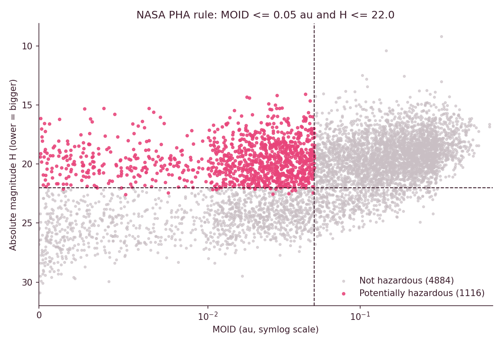
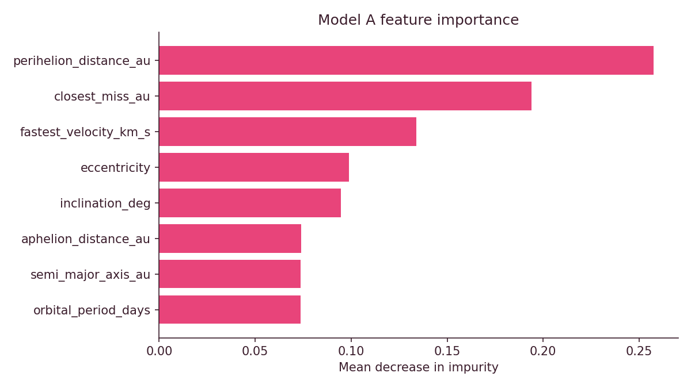

# Hazardous Asteroid Classifier (NASA NeoWs)



Predicts which near-Earth asteroids NASA flags as Potentially Hazardous Asteroids (PHAs),
using 6,000 asteroids from NASA's NeoWs API, and checks the labels by recovering NASA's
published PHA rule with a two-level decision tree.

| Model | Features | Hazardous precision | Hazardous recall |
|---|---|---|---|
| A - random forest | close-approach + orbit shape (no MOID, H or size) | 0.541 | **0.448** |
| B - decision tree, depth 2 | MOID + H only | 1.000 | **0.987** |

Test set: stratified 20% hold-out, 1,200 asteroids, 223 hazardous. Single split, seed 42.

> Learning project. Not a planetary-defence tool. For real asteroid risk information see
> NASA JPL CNEOS.

## How it works

- NeoWs (Near Earth Object Web Service) gives size, brightness, close approaches and orbit
  elements for each near-Earth asteroid, plus the label `is_potentially_hazardous_asteroid`.
- NASA's rule for that label is public: an asteroid is a PHA if its **minimum orbit
  intersection distance (MOID) <= 0.05 au** and its **absolute magnitude H <= 22.0**
  (roughly larger than ~140 m).
- So the label is essentially one `if` statement:

```python
hazardous = moid <= 0.05 and h <= 22.0
```

- **Model A** must learn the label without MOID, H or diameter (diameter is computed from H,
  so it would leak). It only sees how close past/future approaches were, approach speed and
  the orbit's shape.
- **Model B** is given MOID and H and only two levels of splits. If the data and labels are
  right, it should rediscover the rule.

## Results

**Class balance:** 1,116 hazardous (18.6%) vs 4,884 not hazardous (81.4%). A model that
always says "safe" would be 81% accurate and catch zero threats, which is why recall on the
hazardous class is the headline metric, not accuracy.

**Model B (rule check)** learned `MOID <= 0.0499 au` then `H <= 22.045`, matching NASA's
0.05 au / 22.0 thresholds. It misses 3 of 223 hazardous test asteroids and raises no false
alarms. Near-perfect here does **not** mean the model is clever; it shows that the downloaded
labels line up with NASA's definition, so the pipeline read the data correctly.

**Why it is not 100%:** applying the rule directly agrees with the label on 99.70% of rows
(18 of 6,000 disagree). 17 of those are labelled hazardous but have H between 22.01 and
22.57, just over the limit; one has H = 22.00 exactly and is labelled not hazardous. The most
likely explanation is that H estimates were revised after the PHA flag was set, or the flag
uses a differently rounded value. This was not verified against JPL.

**Model A (the real challenge)** catches 100 of 223 hazardous asteroids (recall 0.448) with
85 false alarms (precision 0.541). Confusion matrix (rows = true, columns = predicted):

|  | safe | hazardous |
|---|---|---|
| **safe** | 892 | 85 |
| **hazardous** | 123 | 100 |

It does clearly worse than Model B, which is the expected result: without size (H), the
model cannot tell a 1 km asteroid from a 20 m one on the same orbit. Its most useful
features are perihelion distance and closest observed miss distance, both proxies for MOID.



**Sampling bias to know about:** NeoWs `browse` lists objects in catalogue order, so early
pages hold older, mostly larger discoveries. Pages 0-49 are 28% hazardous, pages 250-299 are
8%. The 18.6% overall share is therefore higher than for the full NEO catalogue, and the
metrics above apply to this sample only.

## Data handling

- One row per asteroid: id, name, H, estimated diameter (min/max km), closest miss distance
  (au) and fastest relative velocity (km/s) over all `close_approach_data` entries, and MOID,
  eccentricity, inclination, semi-major axis, perihelion, aphelion and orbital period from
  `orbital_data`. Saved as `asteroids.csv`.
- 324 asteroids have no close-approach entries; Model A fills those two features with the
  training-set median (imputer fitted inside the training pipeline only).
- Model A's feature list is printed and asserted not to contain MOID, H or diameter.

## Run it

1. Get a free key at [api.nasa.gov](https://api.nasa.gov/) and set it **in your shell only**
   (never in a file):

   ```powershell
   $env:NASA_API_KEY = "your-key"
   ```

2. Install and run (Windows PowerShell):

   ```powershell
   python -m venv .venv
   .\.venv\Scripts\python.exe -m pip install -r requirements.txt
   .\.venv\Scripts\python.exe fetch_data.py
   .\.venv\Scripts\python.exe train.py
   ```

`fetch_data.py` downloads pages 0-299 (size 20), sleeps 1 s between requests, retries
network/server errors up to 3 times, stops on 401/403/429, and caches every page in
`data/cache/` so reruns make no API calls. The key is read from `NASA_API_KEY` and never
written or printed. NeoWs echoes the key inside every `links` URL of its responses, so the
script replaces it with `REDACTED` before writing each cached page. Do not use `DEMO_KEY`: it allows only 30 requests per hour.

`asteroids.csv` (built from the cache, contains no key) is included so `train.py` can be run
without downloading. Outputs: `outputs/metrics.json`, `outputs/train_log.txt`,
`outputs/moid_vs_h.png`, `outputs/feature_importance.png`.

## Limitations

- 6,000 asteroids from the first 300 browse pages, not the full catalogue (see sampling bias).
- One random split; no cross-validation or confidence intervals.
- Model A's threshold is the default 0.5. A planetary-defence use would lower it to trade
  precision for recall.

## Credits

NASA Open APIs - Asteroids NeoWs (data from the JPL Small-Body Database).
PHA definition: NASA JPL Center for Near Earth Object Studies (CNEOS).
